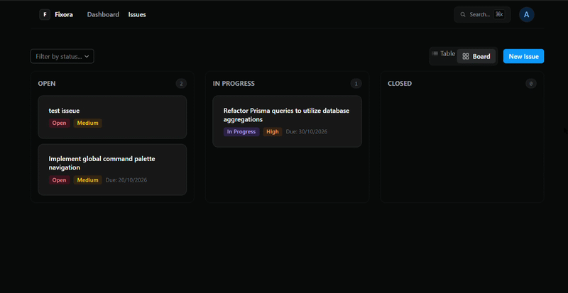
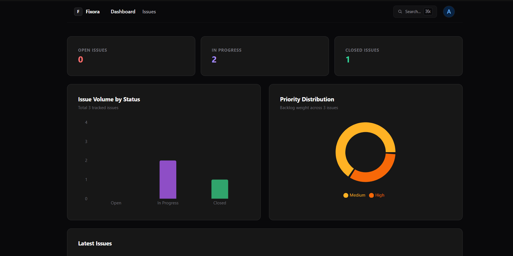

# Fixora

I built Fixora because I wanted to engineer an issue tracker that actually feels fast. Instead of building another standard CRUD application, I focused entirely on power-user ergonomics: zero-latency state updates, global keyboard shortcuts, and database-level analytics. 

<div align="center">
   
  
</div>

## 🚀 The Engineering Behind the Features

* **Zero-Latency Kanban Board:** I implemented optimistic UI state management using `@hello-pangea/dnd`. When you drag a ticket, the UI updates instantly while a background `PATCH` request syncs the state to PostgreSQL. I also built in error boundaries to automatically revert the card if the database transaction fails.
* **Global Command Palette (`Ctrl+K`):** To optimize navigation, I integrated a keyboard-first, headless command menu using `cmdk`. It sits at the layout level, intercepting global keystrokes so users can search and jump between routes without touching the mouse.
* **Database-Driven Telemetry:** For the dashboard, I bypassed client-side counting entirely. I wrote Prisma `groupBy` and `count` aggregations to force the PostgreSQL engine to compute the status and priority distributions, feeding only the final integers to the Next.js server to render the Recharts visualizations.
* **Custom Minimalist UI:** I stripped out the bulky default component styles in favor of a custom, deep-dark monochromatic aesthetic (`#09090b`), utilizing transparent surfaces and subtle borders to keep the interface clean and focused.

<div align="center">
  
</div>

## 🛠 What I Used to Build It

* **Framework:** Next.js 14 (App Router)
* **Database & ORM:** PostgreSQL & Prisma
* **Type Safety & Validation:** TypeScript & Zod
* **Authentication:** NextAuth.js
* **UI & Data Viz:** Tailwind CSS, Radix UI, Recharts, `cmdk`

## 🏗 Architecture Notes

I structured Fixora to strictly separate server and client concerns. I used Server Components for direct, latency-free database querying and authorization checks. I reserved Client Components exclusively for interactive surfaces—like the Kanban board, the command menu, and the SVG charts. Every API mutation is strictly validated through Zod schemas before touching the Prisma client to ensure database integrity.

## ⚙️ How to Run This Locally

If you want to spin up Fixora on your own machine, follow these steps:

1. **Clone the repository:**
   ```bash
   git clone [https://github.com/yourusername/fixora.git](https://github.com/yourusername/fixora.git)
   cd fixora